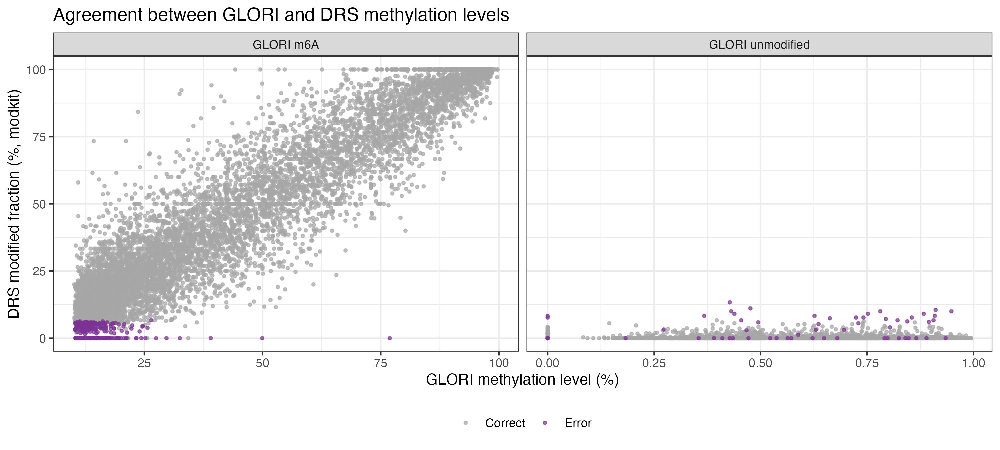
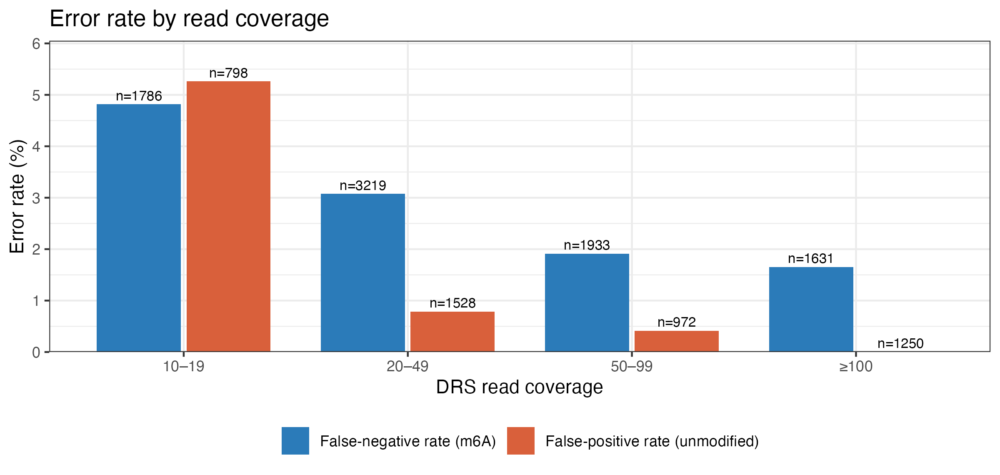

# Sources of error in nanopore direct RNA m6A calling

MSc Bioinformatics project, University of Copenhagen (2026)
Riya Aggarwal, supervised by Sarah Rennie

Nanopore direct RNA sequencing (DRS) can detect N6-methyladenosine (m6A) on native RNA. Dorado gives each read a probability that the adenosine in a DRACH motif is methylated, and modkit turns these into site-level calls. How often these calls are wrong, and at which sites, is less well understood.

In this project I compared DRS m6A calls from HEK293T cells with labels from GLORI, a chemical method that measures m6A at single-nucleotide resolution. I trained XGBoost classifiers to predict the GLORI label from DRS-derived features, then looked at the sites the model got wrong to find out what they have in common.

## Main findings

- Dorado's per-read probabilities alone reproduce the GLORI labels almost perfectly (ROC-AUC 0.995). Adding sequence context, base quality and coverage barely improves this (0.998).
- The most useful feature is the standard deviation of the per-read probabilities, not the median. About half of the methylated sites have a median probability as low as unmethylated sites, because most sites are only partially methylated. The few modified reads at these sites show up in the spread.
- False m6A calls happen almost only at low coverage. The false-positive rate is 5.3% at 10–19 reads and 0% at 100 reads or more. At a site with few reads, one or two high-probability reads are enough to make it look methylated.
- Missed m6A sites are mostly weakly methylated (median GLORI level 13.6%, compared with 37.7% for detected sites). They are also more common in less frequent DRACH contexts (AAACA, TGACC, AGACC) and in the 5'UTR.
- Base quality plays no role in either type of error.

## Data

- **DRS:** HEK293T direct RNA sequencing, four flow cells. Not included in this repository.
- **GLORI:** published HEK293T GLORI data (Liu et al., 2023, *Nature Biotechnology*). Sites covered by more than 100 reads in both replicates were used. Positives have a methylation level above 10% and negatives below 1% in both replicates.

Raw and intermediate data are not included because of their size.

## Pipeline

1. **Basecalling and alignment.** Dorado v2.0.1 with the m6A DRACH model, aligned to GRCh38. BAMs from the four flow cells were merged and indexed with samtools v1.21.
2. **Site-level calls.** `modkit pileup` (v0.4.2) restricted to the central adenosine of DRACH motifs (`--motif DRACH 2`). Sites with at least 10 reads were kept, giving 570,984 sites.
3. **Labelling.** modkit coordinates (0-based) were converted to GLORI coordinates (1-based) and matched on chromosome, position and strand.
4. **Features.** Per-read modification probabilities and base qualities were extracted with `modkit extract full`. For each site I computed the median, 25th and 75th percentiles and standard deviation of the m6A probabilities, the quartiles of base quality, read coverage, and the 5-mer context from the reference genome (one-hot encoded at positions −2, −1, +1, +2).
5. **Train/test split.** Chromosomes 1, 17 and 21 were held out for testing to avoid leakage between nearby, correlated sites.
   - Training: 3,290 sites, balanced (1,645 per class)
   - Test: 13,117 sites, 65.3% positive
6. **Model training.** XGBoost with hyperparameters tuned by 5-fold cross-validation, where folds were grouped by chromosome. Out of 72 configurations, I picked the simplest one whose PR-AUC was within one standard deviation of the best.
7. **Error analysis.** Misclassified test sites were compared with correct ones by methylation level, coverage, 5-mer, transcript region and SHAP contributions.

## Models

| Model | Features | Max depth | Learning rate | Rounds |
|---|---|---|---|---|
| 1 | Sequence context, base quality, coverage | 3 | 0.01 | 100 |
| 2 | Dorado m6A probabilities only | 3 | 0.05 | 100 |
| 3 | All features | 3 | 0.05 | 100 |

The modkit modified fraction was deliberately left out as a feature. It summarises the same probabilities after a hard threshold, whereas the probability statistics keep the full distribution.

## Results

Performance on the held-out chromosomes (precision and recall at a threshold of 0.5). CV values are mean ± SD across the five folds.

| Model | CV ROC-AUC | Test ROC-AUC | Test PR-AUC | Precision | Recall |
|---|---|---|---|---|---|
| 1 (sequence + quality + coverage) | 0.877 ± 0.015 | 0.874 | 0.922 | 0.886 | 0.763 |
| 2 (probabilities only) | 0.994 ± 0.003 | 0.995 | 0.998 | 0.993 | 0.971 |
| 3 (all features) | 0.996 ± 0.001 | 0.998 | 0.999 | 0.994 | 0.975 |

Baseline PR-AUC for the test set is 0.653. Test ROC-AUC closely matches CV ROC-AUC for all three models, so they generalise to unseen chromosomes.

Errors on the test set (8,569 m6A sites, 4,548 unmodified sites):

| Model | Missed m6A sites (FN) | False m6A calls (FP) |
|---|---|---|
| 1 | 2,035 | 840 |
| 2 | 249 | 58 |
| 3 | 216 | 51 |

Most of Model 1's errors (96%) are fixed by Models 2 and 3. Most of Model 2's errors (82%) are also made by Model 3, so adding features barely helps once the probabilities are in.

### Where Model 2 goes wrong

The detailed error analysis uses Model 2. It only sees Dorado's probabilities, so its errors mark the sites where Dorado's signal disagrees with GLORI. Model 3 would hide some of these with its extra features.

Most errors are not borderline cases. Many false negatives get probabilities close to 0 and many false positives close to 1, so moving the threshold would not fix them.

**Missed sites are weakly methylated.** 90% of false negatives have a GLORI level below 20%, and almost all have a DRS modified fraction close to 0. Some of these may not be methylated at all, since they sit just above the GLORI cut-off.

**False positives disappear with coverage.** The false-positive rate falls from 5.3% at 10–19 reads to 0% at 100 reads or more. False negatives drop more slowly, from 4.8% to 1.6%, because low methylation, not low coverage, is their main cause.

**Sequence context and transcript region affect only missed sites.**

| 5-mer | Sites | False negatives | Rate (%) | Adjusted p |
|---|---|---|---|---|
| AAACA | 64 | 7 | 10.9 | 0.012 |
| TGACC | 90 | 8 | 8.9 | 0.017 |
| AGACC | 231 | 16 | 6.9 | 0.008 |
| GAACC | 216 | 13 | 6.0 | 0.035 |
| TGACA | 201 | 12 | 6.0 | 0.042 |
| GGACA | 1,161 | 15 | 1.3 | 0.002 |

The overall false-negative rate is 2.9%. No 5-mer differed in its false-positive rate (Fisher's exact test, BH-adjusted).

The false-negative rate in the 5'UTR is 7.4%, more than twice the overall rate. Two likely reasons: DRS reads the 5' end of RNA molecules poorly, and some of these sites may carry cap-adjacent m6Am, which GLORI cannot tell apart from m6A.

## Limitations

- Only DRACH sites from one cell line were analysed.
- Few GLORI negatives fall in DRACH motifs, which limited the training set to a few thousand sites. It also means the test set has more methylated than unmethylated sites, unlike real transcriptomes.
- The 0.5 threshold was not adjusted to the test set's class balance, read length was not used as a feature, and SHAP values were computed only for Model 2.

## Software

Dorado 2.0.1, modkit 0.4.2, samtools 1.21. R with xgboost, tidyverse, data.table, pROC, PRROC, patchwork, Biostrings and BSgenome.Hsapiens.UCSC.hg38.

## Key references

- Liu C. et al. (2023). Absolute quantification of single-base m6A methylation in the mammalian transcriptome using GLORI. *Nature Biotechnology* 41, 355–366.
- Chen T. & Guestrin C. (2016). XGBoost: a scalable tree boosting system. *KDD*, 785–794.
- Lundberg S. M. et al. (2020). From local explanations to global understanding with explainable AI for trees. *Nature Machine Intelligence* 2, 56–67.
- Zou Y. et al. (2025). A comparative evaluation of computational models for RNA modification detection using nanopore sequencing with RNA004 chemistry. *Briefings in Bioinformatics* 26(4), bbaf404.